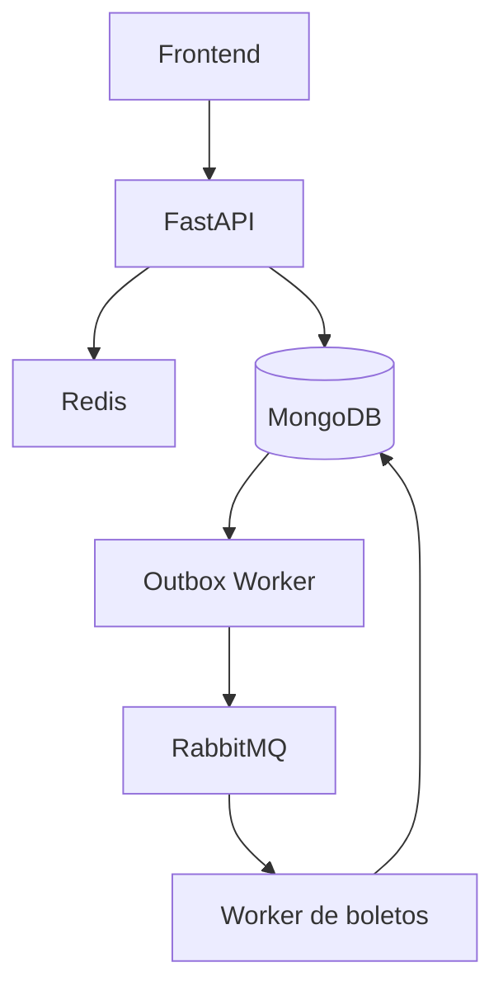

# CineNow

Sistema web de reservación y compra de boletos de cine.

## Descripción

CineNow es una aplicación web que permite consultar la cartelera,
seleccionar funciones, elegir asientos y realizar compras simuladas
de boletos de cine.

El sistema integra una API REST, bases de datos NoSQL y mensajería
asíncrona mediante RabbitMQ para la generación de boletos.

## Tecnologías utilizadas

### Frontend

- HTML5
- CSS3
- JavaScript
- Apache (XAMPP)

### Backend

- Python
- FastAPI
- Uvicorn
- JWT para autenticación

### Bases de datos y mensajería

- MongoDB: almacenamiento persistente de información.
- Redis: reserva temporal de asientos.
- RabbitMQ: procesamiento asíncrono de compras.
- Pika 1.5.0: comunicación entre Python y RabbitMQ.

## Funcionalidades

- Registro e inicio de sesión.
- Consulta de cartelera.
- Visualización de información de películas.
- Selección de fechas y funciones.
- Selección y reserva temporal de asientos.
- Simulación de pagos.
- Generación asíncrona de boletos.
- Consulta del historial de compras y boletos.
- Prevención de boletos duplicados.
- Reintento de publicación de eventos pendientes.
- Reconexión del consumidor ante errores de conexión.

## Arquitectura del sistema



## Funcionamiento de RabbitMQ

1. El usuario selecciona sus asientos.
2. Redis realiza la reserva temporal.
3. FastAPI registra la compra y el pago simulado.
4. MongoDB almacena la compra pagada y el evento pendiente.
5. El Outbox Worker publica el evento en RabbitMQ.
6. RabbitMQ almacena el mensaje en la cola generar_boleto.
7. El consumidor recibe el mensaje y genera los boletos.
8. Los boletos se almacenan en MongoDB.
9. El consumidor confirma el procesamiento del mensaje.
10. El frontend consulta los boletos disponibles.

Se utiliza una variante del patrón Transactional Outbox,
almacenando el indicador del evento pendiente dentro del
documento de compra.

La cola es durable y utiliza mensajes persistentes.

La generación de boletos es idempotente mediante un índice
único compuesto por compra_id y asiento.

## Estructura del proyecto

```text
CineNow/
├── frontend/
│   ├── index.html
│   ├── styles.css
│   ├── app.js
│   └── img/
├── backend/
│   ├── database/
│   ├── models/
│   ├── routers/
│   ├── services/
│   │   ├── rabbitmq_service.py
│   │   ├── boletos_service.py
│   │   └── outbox_service.py
│   ├── main.py
│   ├── worker.py
│   ├── outbox_worker.py
│   ├── requirements.txt
│   └── .env.example
├── database_export/
├── .gitignore
└── README.md
```

## Requisitos de instalación

- Python 3.13
- Git
- MongoDB Community Server
- MongoDB Compass (opcional)
- XAMPP
- WSL2 con Ubuntu
- Redis
- RabbitMQ

## Instalación

### 1. Clonar el repositorio

```powershell
git clone https://github.com/EricKayn/CineNow.git
cd CineNow
```

Si la integración todavía se encuentra en su rama de desarrollo:

```powershell
git switch feature/rabbitmq
```

### 2. Configurar el backend

```powershell
cd backend
python -m venv .venv
.\.venv\Scripts\python.exe -m pip install -r requirements.txt
```

### 3. Configurar las variables de entorno

```powershell
Copy-Item .env.example .env
```

Configurar el archivo .env:

```env
MONGO_URI=mongodb://localhost:27017/
SECRET_KEY=REEMPLAZAR_CON_UNA_CLAVE_SEGURA
RABBITMQ_HOST=localhost
RABBITMQ_PORT=5672
```

Generar una clave secreta:

```powershell
.\.venv\Scripts\python.exe -c "import secrets; print(secrets.token_hex(32))"
```

Guardar la clave generada en SECRET_KEY.

No compartir ni publicar el archivo .env.

### 4. Configurar MongoDB

Crear una base de datos llamada cine_db.

Importar los archivos JSON de database_export en las
colecciones correspondientes:

- peliculas
- cines
- salas
- funciones

Las funciones deben tener fechas vigentes para realizar compras.

### 5. Instalar Redis y RabbitMQ

Desde Ubuntu en WSL2:

```bash
sudo apt update
sudo apt install redis-server rabbitmq-server -y
sudo rabbitmq-plugins enable rabbitmq_management
```

### 6. Configurar el frontend

Copiar el contenido de frontend a:

```text
C:\xampp\htdocs\cine_web\
```

Iniciar Apache desde el panel de control de XAMPP.

## Ejecución del sistema

### Terminal Ubuntu

```bash
sudo service redis-server start
sudo service rabbitmq-server start
```

### Terminal 1: API REST

Desde la carpeta backend:

```powershell
.\.venv\Scripts\python.exe -m uvicorn main:app --reload
```

### Terminal 2: Publicador de eventos

Desde la carpeta backend:

```powershell
.\.venv\Scripts\python.exe outbox_worker.py
```

### Terminal 3: Consumidor de RabbitMQ

Desde la carpeta backend:

```powershell
.\.venv\Scripts\python.exe worker.py
```

MongoDB y Apache también deben estar activos.

## Direcciones de acceso

| Servicio | Dirección |
|---|---|
| CineNow | http://localhost/cine_web/ |
| API REST | http://localhost:8000 |
| Swagger | http://localhost:8000/docs |
| RabbitMQ Management | http://localhost:15672 |

## Pruebas realizadas

- Registro e inicio de sesión.
- Consulta de películas y funciones.
- Reserva de asientos.
- Pago simulado.
- Publicación de eventos en RabbitMQ.
- Almacenamiento de mensajes con el consumidor detenido.
- Recuperación de mensajes al reactivar el consumidor.
- Generación de boletos sin duplicados al repetir un evento.
- Visualización de boletos generados de forma asíncrona.

## Consideraciones

El sistema está diseñado para un entorno académico local.

Los pagos son simulados y no se realizan cargos bancarios reales.

La versión de Pika se encuentra fijada debido a la futura
eliminación de BlockingConnection.

El sistema no implementa todavía una cola de mensajes fallidos
ni un límite de reintentos para todos los errores del consumidor.

## Estado del proyecto

Proyecto académico funcional desarrollado con fines educativos
para la materia de Bases de Datos NoSQL.

Integra almacenamiento documental, almacenamiento en memoria,
servicios REST y mensajería asíncrona.